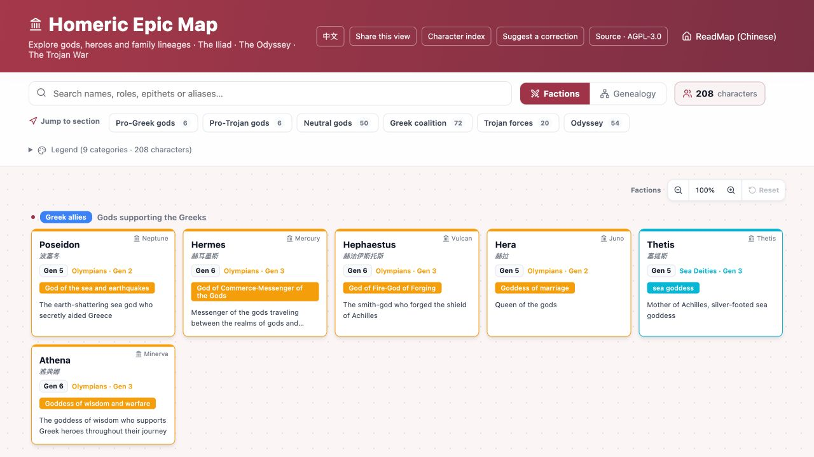
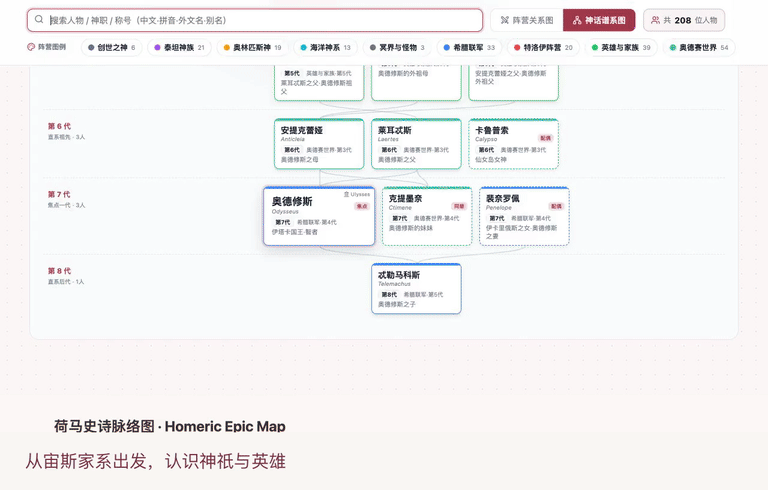

# Homeric Epic Map · Greek Mythology and Family Trees

[中文](README.md) · **English**

[](LICENSE)

**Original project code is licensed under [AGPL-3.0-only](LICENSE), version 3 only.** Modified network services must comply with the license's corresponding-source requirements for their users.

An interactive reading companion for the **Iliad**, the **Odyssey** and **Greek mythology**. Explore gods, heroes, family relationships and Trojan War factions in Chinese or English.

**Public snapshot: 208 characters · 9 categories · 328 relationships · 3 views · No database required**

**[Open the English map](https://homeric-epic.inklinks.io/en/)** · [中文网站](https://homeric-epic.inklinks.io/)

The independent site follows this repository's versions; send corrections through [GitHub Issues](https://github.com/adonisly/homeric-epic-map/issues). English content is machine-assisted translation of the Chinese study notes, with selected terminology and central summaries manually edited. It remains open to scholarly and editorial correction.

A bilingual **Homeric epic map**, **Greek mythology family tree** and **Iliad / Odyssey character relationship map**. Search English, Chinese, Roman names, aliases, pinyin and initials. Runs from bundled public JSON without an account, database or API key.

[](https://homeric-epic.inklinks.io/en/)

## Operation demo

[Watch the approximately 21-second walkthrough (MP4, approximately 1 MB, Chinese captions)](assets/demo.mp4) · [Recording notes and storyboard (Chinese)](docs/DEMO.md)

<details>
<summary>View the 15-second animated preview (Chinese interface and captions)</summary>



</details>

These recordings show the original Chinese interface; the legend was subsequently made collapsed by default, as explained in the recording notes. Explore the same graph in the [live English edition](https://homeric-epic.inklinks.io/en/).

## Get started in 30 seconds

1. Begin with Zeus in **Family view** to explore direct ancestors, contemporaries, partners and descendants.
2. Search for “Odysseus”, “奥德修斯” or “adxs”, choose a suggestion and open the character details.
3. Choose **Full genealogy** for generations across the wider graph, or **Factions** for Greek, Trojan and divine alignments. Switch 中文 / English in the header while keeping the current view and focus.

Use **Source · AGPL-3.0** in the header to visit GitHub and star the project. Include a reliable source when [reporting a correction](https://github.com/adonisly/homeric-epic-map/issues).

## Share and explore

- **Share this view** preserves the language, view, genealogy mode, focus, category and search. **Share this character** additionally opens that character's details.
- Both editions use the same stable IDs. Links work under the current domain and deployment directory; unrelated host parameters are removed. Zoom, scrolling and local navigation history are not included.
- The [English character index](https://homeric-epic.inklinks.io/en/explore/) can be read without JavaScript. It is navigation generated from this public snapshot, not the full name index of a modern translation.
- Examples: [Zeus's family](https://homeric-epic.inklinks.io/en/?view=tree&mode=ego&focus=zeus), [Achilles](https://homeric-epic.inklinks.io/en/?view=tree&mode=ego&focus=achilles&figure=achilles), [Odysseus](https://homeric-epic.inklinks.io/en/?view=tree&mode=ego&focus=odysseus&figure=odysseus).

## Online editions and further reading

**[Homeric epic on ReadMap (Chinese)](https://readmap.inklinks.io/knowledge-graphs/homeric-epic)**

This map originated in [ReadMap](https://readmap.inklinks.io/), a Chinese-language reading platform connecting structured reading routes, knowledge maps and resources. The main site uses the shared core with separately maintained data, feedback and host capabilities.

- [Reading routes](https://readmap.inklinks.io/reading-paths): learning paths by subject.
- [More knowledge maps](https://readmap.inklinks.io/knowledge-graphs): [Western philosophy](https://readmap.inklinks.io/knowledge-graphs/western-philosophy), [Western music](https://readmap.inklinks.io/knowledge-graphs/western-music), [Buddhist history](https://readmap.inklinks.io/knowledge-graphs/buddhism-history) and [Chinese dynasties](https://readmap.inklinks.io/knowledge-graphs/chinese-dynasties).
- [Reading community](https://bookclub.inklinks.io/): an external companion community.
- [Resource search](https://readmap.inklinks.io/pan-search) and [course resources](https://readmap.inklinks.io/resources): both require an access passcode.

These destinations are primarily Chinese. The independent English edition focuses on the public map and is not a complete copy of the main site's content or features.

## Explore Homeric epic through a character map

- Trace a character's direct family line, siblings, partners and descendants.
- Follow the wider genealogy using recorded parent relationships and generations.
- Compare Greek and Trojan forces, divine supporters and Odyssey characters.
- Read roles, epithets, biographies and variant notes, then select relatives to continue exploring.
- Search canonical names, Roman names, alternative spellings, Chinese or pinyin; share a character or view with another reader.

## Coverage: gods, heroes and family lineages

The snapshot combines epic characters with mythological background useful for reading:

- **Divine genealogies:** primordial deities, Titans, Olympians, sea deities and underworld figures.
- **The Iliad and Trojan War:** Achilles, Agamemnon, Hector, Priam, Helen and their families and allies.
- **The Odyssey:** Odysseus, Penelope, Telemachus, their household and figures encountered on the homeward voyage.
- **Heroic families:** genealogical links that help explain relationships across traditions.

This is not an exhaustive mythology. Not every character or relationship appears in Homer, and traditions have variants. Recorded confidence labels are retained; translation does not upgrade them into verified facts.

## Learning and use

### How do I follow the characters of the Iliad and Odyssey?

Search a character, read the summary and relatives, then use Factions or a genealogy view to place them in context. Check important details against the text, a reliable commentary or scholarly reference.

### Can I use this as a mind map or family tree?

Yes, as a study and reading companion. Parent arrows, gender-aware kinship labels and selectable relatives help with navigation. The summaries and genealogies are evolving notes, and English prose remains an editorial draft.

### Do I need a database or an account?

No. Online browsing, local use and static deployment use bundled JSON. React, TypeScript and custom DOM / SVG rendering provide the interface; visitors do not call a translation API.

## Run locally

Use Node.js 22.12 or newer; CI uses Node.js 24.

```bash
npm ci
npm run dev
```

Open `http://127.0.0.1:3200/` for Chinese or `http://127.0.0.1:3200/en/` for English.

```bash
npm test
npm run check:translations
npm run build
npm run preview
```

Deploy `dist/` to a static host. `/en/index.html` is a real entry point, so English routes do not require a host-specific SPA fallback. Relative assets support deployment under a directory.

## Features and data

- Chinese / English UI, character cards, details, kinship, search, sharing and static indexes.
- Three views: Family view, Full genealogy and Factions; zoom, relationship highlights and local search history.
- `public/data/homeric.json` supplies the public graph; `snapshot-info.json` records counts, provenance and SHA-256.
- `public/data/locales/en.json` stores source-matched translations by stable ID. The build checks coverage and freshness separately from editorial review.

**Excluded:** the full original name index and definitions from modern translations, unreviewed images, user data, comments, private service configuration and production writes. `nameIndex=[]` and `image_url=null` remain unchanged.

The static site does not automatically receive main-site database updates. Public code and data contributions do not directly modify production data.

## Contribute

See [CONTRIBUTING.md](CONTRIBUTING.md). For factual changes, identify the character or relation, explain the change and provide a reliable source; preserve IDs and relationship direction.

For English revisions, follow [TRANSLATING.md](docs/TRANSLATING.md), update changed source matches only after retranslating, and retain draft labels until reviewed. Keep both READMEs aligned in all 13 sections.

[Sharing notes (Chinese)](docs/SHARING.md), screenshots and demo files are available for introducing the project. Do not include excluded index material or unreviewed images.

## Website search and sharing configuration

The build generates real Chinese / English HTML entries and indexes, self canonicals, reciprocal `hreflang`, localised titles and descriptions, Open Graph / Twitter metadata, four sitemap URLs and robots.txt. These do not guarantee indexing or ranking.

For another domain or directory:

```bash
VITE_SITE_URL=https://example.com/homeric/ VITE_SOURCE_URL=https://github.com/your-name/your-repo/tree/your-commit npm run build
```

Update or remove `public/CNAME`. English social cover: [PNG](public/social-preview-en.png), [editable SVG](assets/social-preview-en.svg); replace its domain for your deployment. GitHub repository Social preview is configured separately in Settings.

For Search Console, set the Actions variable `GOOGLE_SITE_VERIFICATION`, or `VITE_GOOGLE_SITE_VERIFICATION` on another host, to your own public HTML verification value. Unset means no verification tag. Keep the existing verified property when adding `/en/` under the same site.

Versions are documented in [CHANGELOG.md](CHANGELOG.md).

## Reuse the graph core

`src/HomericGraph.tsx` is the shared implementation. `src/main.tsx` loads the public snapshot and translations. Hosts inject `graph`, optional search analytics and feedback links, and optionally `locale`, `translations` and `onLocaleChange`. Existing hosts default to Chinese.

The core does not depend on Next.js, a database, private ReadMap services or a translation API. Merge improvements here first, then have the maintainer import an approved version into ReadMap. Database contributions require a separate reviewed import process, not a full snapshot overwrite.

## License

Original project code is licensed under **GNU Affero General Public License version 3 only (`AGPL-3.0-only`)**. Read [LICENSE](LICENSE), [NOTICE.md](NOTICE.md) and [THIRD-PARTY-NOTICES.md](THIRD-PARTY-NOTICES.md).

Use, modification, redistribution and commercial use are permitted subject to the license's conditions. Modified network services must offer users the corresponding source as required by the license. Forking does not require submitting an upstream PR; see the contribution terms.

The **Source · AGPL-3.0** link identifies the deployed source. Set `VITE_SOURCE_URL` to your actual deployed version; Actions points it at the build commit. Other deployments must review the fallback main-branch URL.

Third-party dependencies and referenced works retain their applicable rights. The project license does not grant additional rights to third-party text, illustrations or the excluded modern-translation index, or imply official affiliation.
