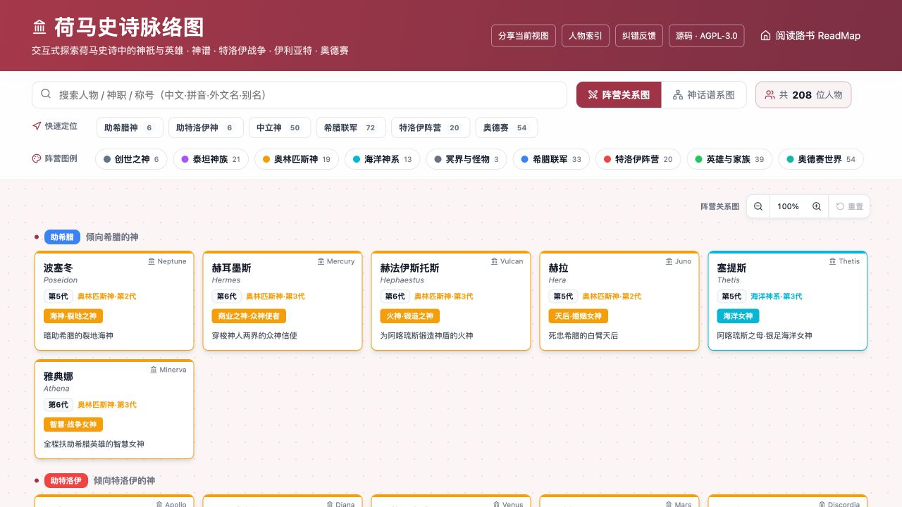
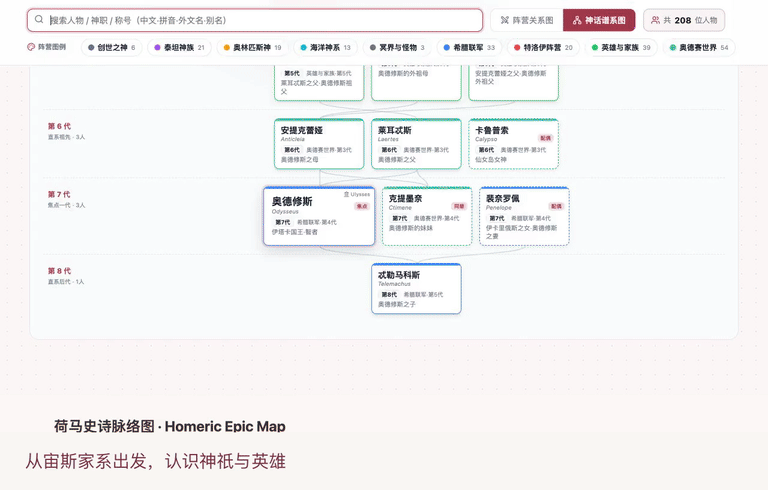

# 荷马史诗脉络图 · 希腊神话人物关系图 | Homeric Epic Map

[](LICENSE)

通过可搜索的**荷马史诗人物关系图、希腊神话谱系图与特洛伊战争阵营图**，梳理《伊利亚特》《奥德赛》中的神祇、英雄与家族关系。适合古希腊文学阅读、希腊神话入门和史诗人物关系复习。

**[在线体验](https://homeric-epic.inklinks.io/)** · **[阅读路书 ReadMap](https://readmap.inklinks.io/)** · [主站荷马史诗图谱](https://readmap.inklinks.io/knowledge-graphs/homeric-epic) · [纠错与建议](https://github.com/adonisly/homeric-epic-map/issues)

当前公开快照：**208 位人物 · 9 个类别 · 328 条关系 · 3 种展示模式 · 无需数据库或账号**。

**原创代码采用 [AGPL-3.0-only](LICENSE)，仅第 3 版。** 第三方依赖保留原许可。修改版本通过网络与用户交互时，应按许可提供该版本的完整对应源码；许可允许遵守条款的商用，不强制给本仓库提 PR。

A Chinese-language, interactive **Homeric epic map** and **Greek mythology family tree**. Explore the Iliad, Odyssey, Olympian gods, heroes, genealogies and Trojan War factions. Search Chinese, English, Roman names, pinyin and initials. React + TypeScript; bundled JSON; no database, login or API key required.



## 30 秒上手

1. 默认从宙斯的「人物谱系」出发，查看父母、配偶和子女，点击人物打开详情。
2. 搜索「奥德修斯」「odysseus」或「adxs」，跟随建议定位人物。
3. 切换「全景谱系」观察代际，或打开「阵营关系图」查看希腊联军、特洛伊阵营与诸神。

[宙斯家系](https://homeric-epic.inklinks.io/?view=tree&mode=ego&focus=zeus) · [阿基琉斯](https://homeric-epic.inklinks.io/?view=tree&mode=ego&focus=achilles&figure=achilles) · [奥德修斯](https://homeric-epic.inklinks.io/?view=tree&mode=ego&focus=odysseus&figure=odysseus) · [人物索引](https://homeric-epic.inklinks.io/explore/)

## 功能与内容范围

- 人物谱系、全景代际谱系、战争阵营关系三个展示模式。
- 中文、英文、罗马名、别名、拼音全拼与首字母搜索，支持神职和称号关键词。
- 人物详情、亲属关系、关系方向、异说提示和类别配色。
- 各视图独立缩放、焦点人物切换、祖先血缘主链与探索历史。
- 本机搜索历史与清除；不上传搜索词，也不加载主站热搜或用户行为数据。
- 分享当前视图、人物详情、焦点和搜索；只保存明确的图谱参数，不保存缩放、滚动或本地历史。
- 无需 JavaScript 即可阅读的静态人物索引、sitemap 和链接预览配置。

本图同时使用《伊利亚特》《奥德赛》和辅助理解的通行希腊神话谱系。不能把所有连线都视为荷马正文直接记载；神话存在异说，重要关系应结合可靠来源核对。

**公开版不包含现代译本的整份专名索引原文及其全部地名／族群／物名释义，也不包含未经审核的插图。** 保留图谱核心与公开人物资料；主站内容更新、专名检索范围、评论与全站统计等宿主能力可能不同。静态版不会自动同步生产数据库，不能描述成主站所有功能与内容的完整镜像。

## 操作演示

[观看实际操作演示](assets/demo.mp4) · [演示分镜与说明](docs/DEMO.md)

<details>
<summary>查看 15 秒动图预览</summary>



</details>

## 本地运行与部署

需要 Node.js 22.12 或更新版本；CI 使用 Node.js 24。

```sh
npm ci
npm run dev
```

打开 `http://127.0.0.1:3200`。检查并构建：

```sh
npm test
npm run build
npm run preview
```

静态产物在 `dist/`。默认站点部署到 GitHub Pages；也可部署到其他静态托管。自行部署时使用自己的域名和实际源码版本：

```sh
VITE_SITE_URL=https://example.com/map/ VITE_SOURCE_URL=https://github.com/your-name/your-repo/tree/your-commit npm run build
```

自建站请修改或移除 `public/CNAME`，替换分享封面中的域名，并设置托管平台的对应域名。`VITE_*` 会进入公开产物，不能放秘密。

Google Search Console 可通过仓库变量 `GOOGLE_SITE_VERIFICATION` 注入 HTML 验证值；其他平台使用 `VITE_GOOGLE_SITE_VERIFICATION`。完成部署后仍需在自己的账号验证资源并提交 sitemap。fork 不会自动继承作者账号。GitHub Social preview 在仓库 Settings 单独上传；不等同于网站 Open Graph。上述配置不保证收录或排名。

## 数据、同步与贡献

公开数据在 `public/data/homeric.json`；字段、关系方向、排除项与校验方法见 [数据说明](docs/DATA.md)。`snapshot-info.json` 记录记录数、来源、导出时间和 SHA-256。

图谱源自 [阅读路书 ReadMap](https://readmap.inklinks.io/)。公开仓库维护核心，主站通过适配器注入数据和统计回调，再引入已审核的公开版本；两边分别发布。数据贡献需审核来源并按记录差异导回主站，不能用公开 JSON 整表覆盖数据库。代码同步不写生产数据。

欢迎附来源提交 Issue 或 PR，见 [贡献指南](CONTRIBUTING.md)。新代码与资料应有明确权利基础，不能提交译本索引、大段书籍原文、第三方插图、用户记录或凭据。维护者对社区贡献没有自动取得额外闭源使用权。

想继续主题阅读？访问 ReadMap 的[阅读路径](https://readmap.inklinks.io/reading-paths)与[更多知识图谱](https://readmap.inklinks.io/knowledge-graphs)。

版本记录见 [CHANGELOG](CHANGELOG.md)，归属见 [NOTICE](NOTICE.md) 与 [第三方声明](THIRD-PARTY-NOTICES.md)。
